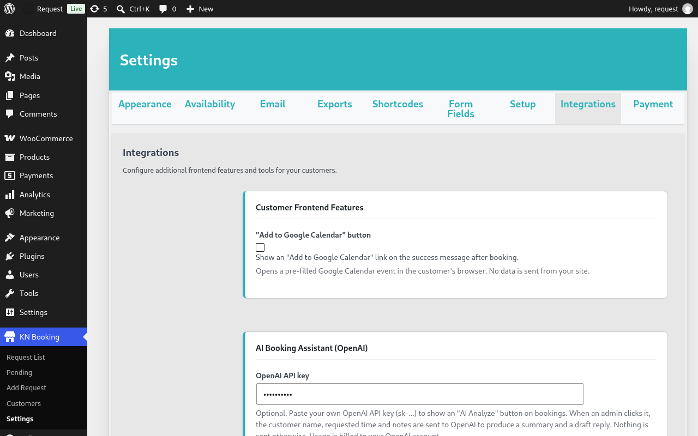
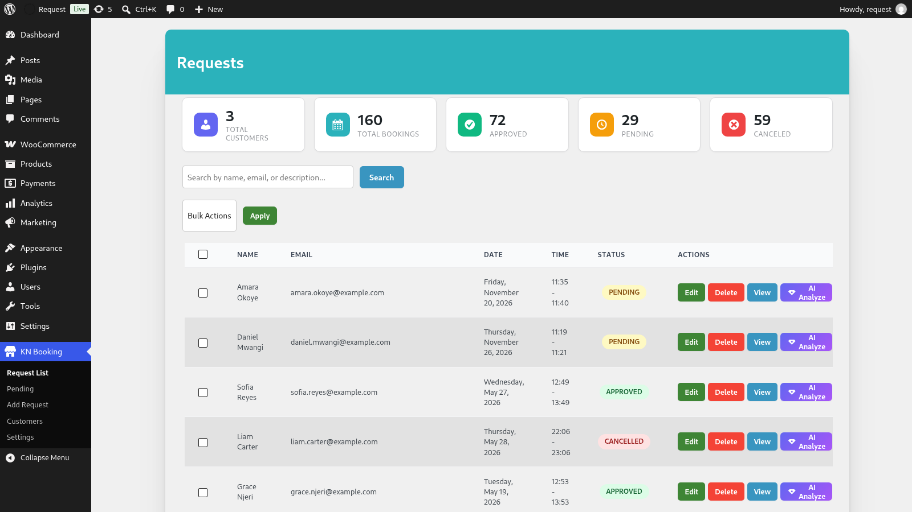
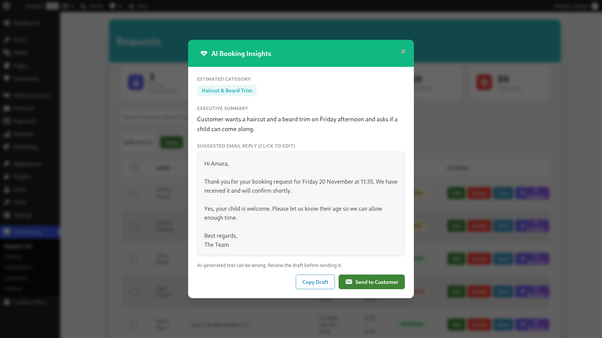

# AI booking assistant

The AI assistant is optional. It reads a booking request and gives you a short summary, a category and a draft reply that you can edit and send. It uses **your own OpenAI account**, so usage is billed to you by OpenAI. It costs a fraction of a cent per booking with the default model.

## 1. Add your API key

Create an API key in your OpenAI account. Then go to **KN Booking > Settings > Integrations**, paste it into **OpenAI API key**, choose a model, and click **Save Changes**.

## 2. Analyze a booking

On **Request List** or **Pending**, click **AI Analyze** next to a booking. The button only shows once a key is saved.

## 3. Review and send the reply

A window shows the estimated category, a summary and a suggested email. Click the text to edit it, then click **Copy Draft** or **Send to Customer**.

AI text can be wrong. Always read the draft before you send it.

## Privacy

Nothing is sent to OpenAI until you click **AI Analyze**. When you do, the customer's name, the requested date and time, and the booking notes are sent to OpenAI to produce the result. If no key is saved, nothing is ever sent. See the [OpenAI privacy policy](https://openai.com/policies/privacy-policy).
