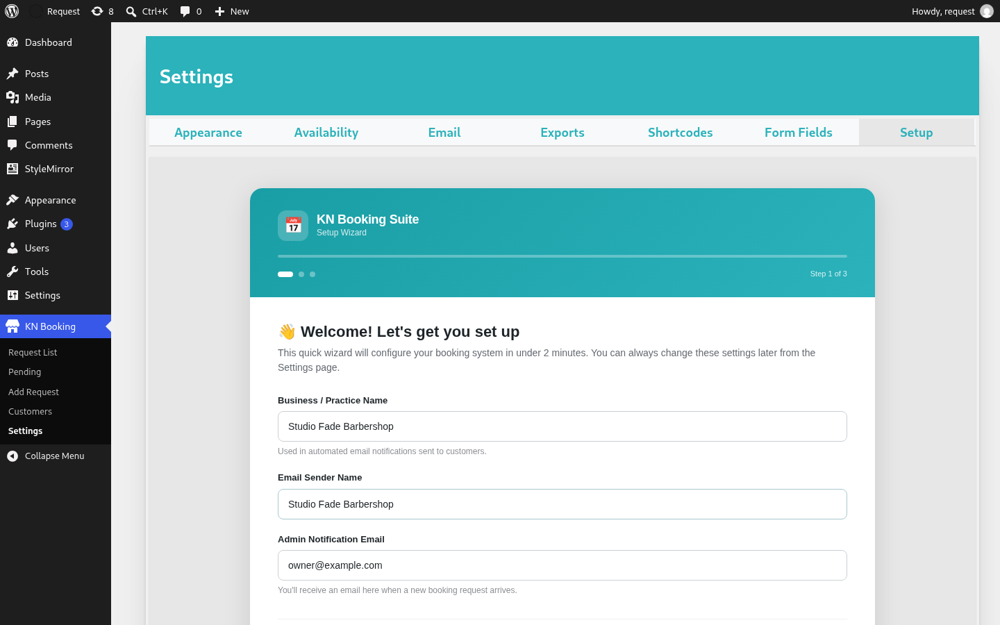
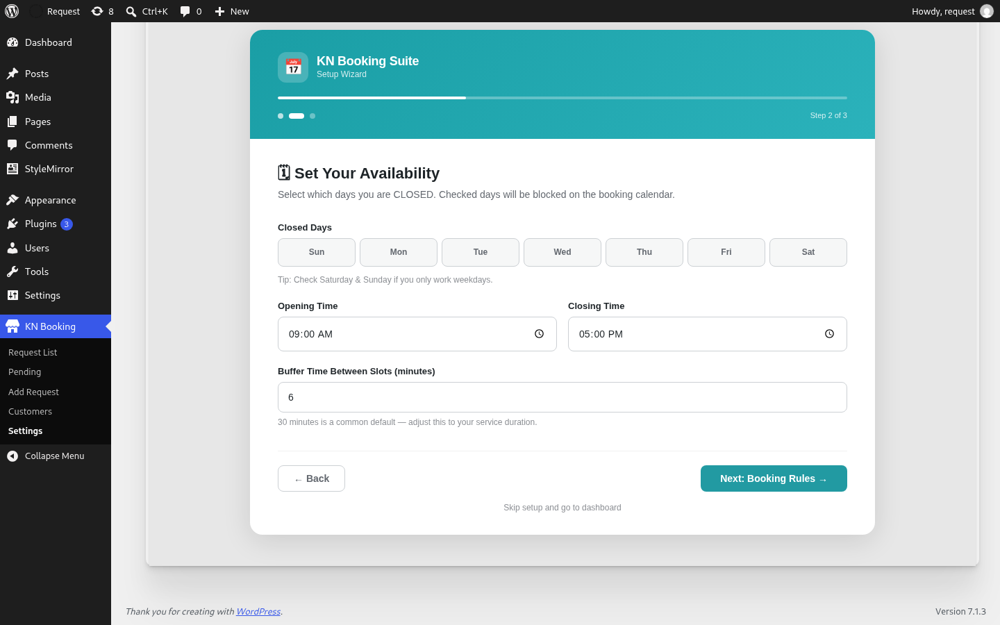
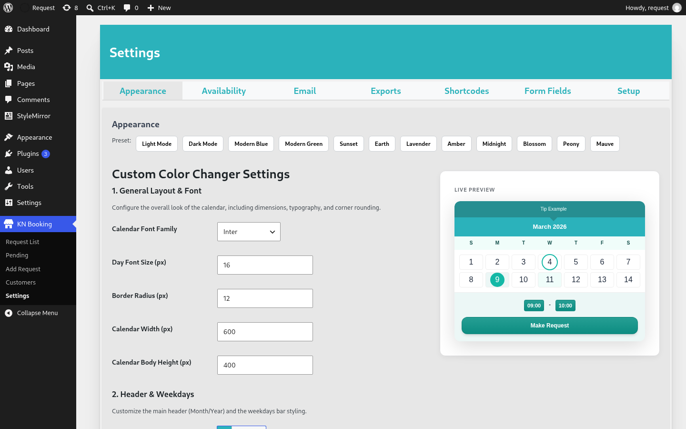
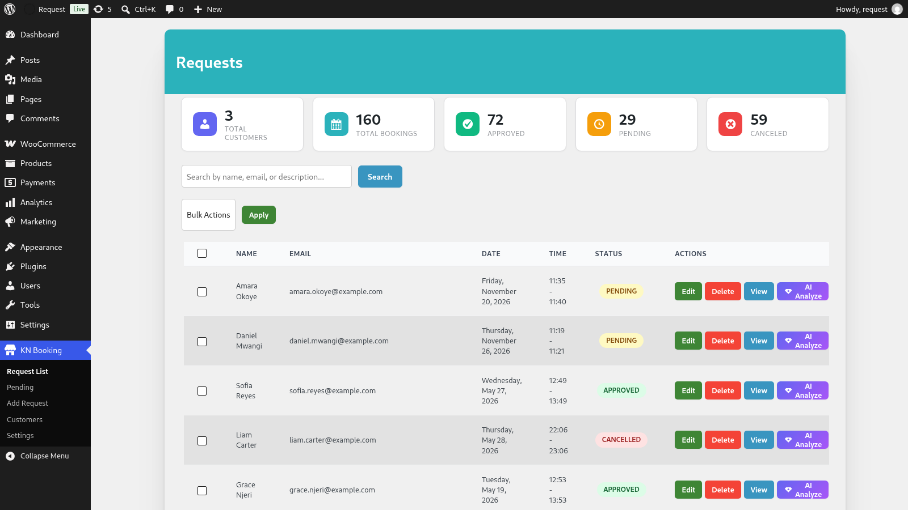

# Getting started

## 1. Install and activate

In your WordPress dashboard go to **Plugins > Add New**, search for **KN Booking**, then click **Install Now** and **Activate**.

## 2. Run the setup wizard

Open **KN Booking > Settings > Setup**. The wizard has three steps.

**Step 1: business info.** Enter your business name and the email address that should receive new booking notifications.



**Step 2: availability.** Choose your closed days, opening hours and the buffer time between appointments.



**Step 3: booking rules.** Set the maximum bookings per day, choose whether new bookings are approved automatically, show a phone number field on the form, and turn on admin email notifications.

You can run the wizard again at any time. It fills in your saved values.

## 3. Show the calendar on a page

Edit any page and add the **Booking Calendar** block, or paste this shortcode:

```
[kn_booking]
```

See [Shortcodes and blocks]({{ site.baseurl }}/shortcodes-and-blocks) for the customer profile page.

## 4. Match your brand

Go to **KN Booking > Settings > Appearance** and pick a colour preset. A live preview shows how the calendar will look.



## 5. Manage bookings

New bookings appear under **KN Booking > Request List** and **Pending**. You can search, approve, edit, cancel or delete each booking, and use bulk actions. Customers and admins receive email notifications you can customise under **Settings > Email**.


