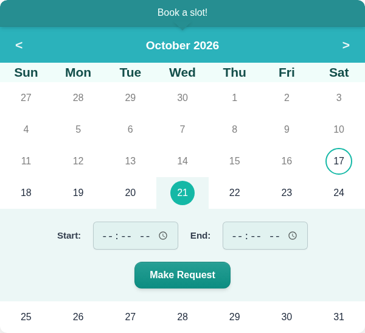

# KN Booking guides

KN Booking is a lightweight appointment booking calendar for WordPress, made for salons, barbershops and other small service businesses. These guides walk you through each feature with screenshots.

## Start here

1. [Getting started]({{ site.baseurl }}/getting-started): install the plugin, run the setup wizard and show the calendar on a page.
2. [Take payment with WooCommerce]({{ site.baseurl }}/payments): charge customers when they book.
3. [AI booking assistant]({{ site.baseurl }}/ai-assistant): summarize a request and draft a reply with your own OpenAI key.
4. [Shortcodes and blocks]({{ site.baseurl }}/shortcodes-and-blocks): where to place the calendar and the customer profile.

Install the plugin from **Plugins > Add New** by searching for "KN Booking", or from the [WordPress.org page](https://wordpress.org/plugins/knvinny-booking-suite/).
