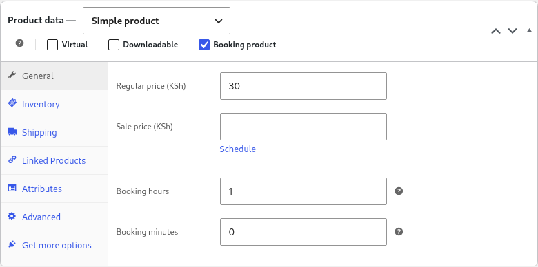
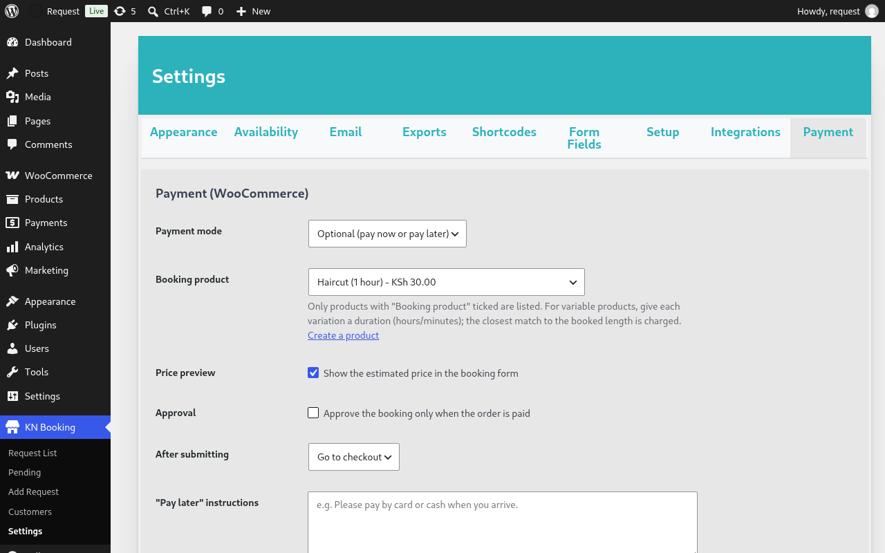
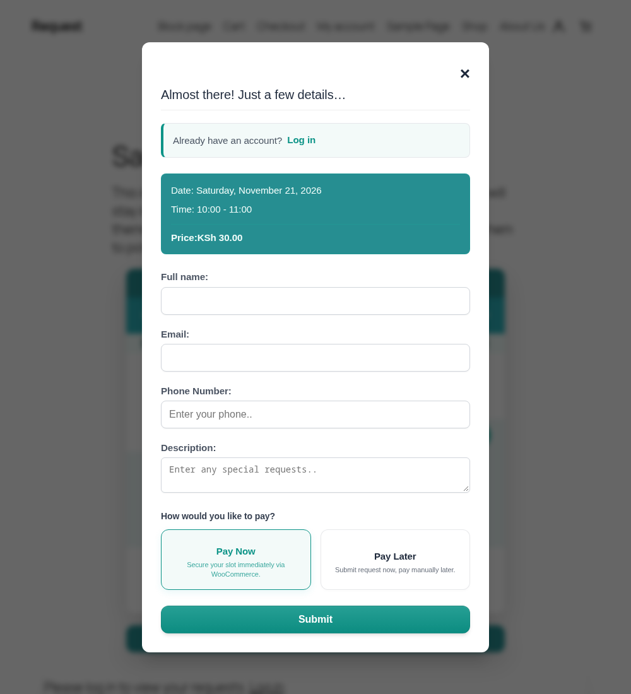

# Take payment with WooCommerce

KN Booking works without any payment. If you want customers to pay when they book, install and activate [WooCommerce](https://wordpress.org/plugins/woocommerce/), then follow these steps.

## 1. Create a booking product

Go to **Products > Add New**, give the product a name and price, and tick **Booking product** in the Product data box. Then set how long the product covers in **Booking hours** and **Booking minutes**.

For a variable product, enter the hours and minutes inside each variation. For example, create a 1 hour variation and a 2 hour variation with different prices.

Booking products are hidden from your shop and from search results.

## 2. Choose your payment settings

Go to **KN Booking > Settings > Payment**.

| Setting | What it does |
|---|---|
| Payment mode | **Disabled** takes free bookings only. **Optional** lets customers pay now or pay later. **Required** sends everyone to checkout. |
| Booking product | The product that is charged. Only products marked as a booking product are listed. |
| Price preview | Shows the estimated price in the booking form. |
| Approval | Keep bookings pending until the WooCommerce order is paid. |
| After submitting | Send the customer to the cart or straight to checkout. |
| "Pay later" instructions | Text shown to customers who choose to pay later. |
| Success message | The message shown after a booking is made. |

Click **Save Changes**.

## 3. What your customers see

After choosing a date and time, the booking form shows the price and, in Optional mode, the Pay Now and Pay Later choices.

When a customer chooses to pay, they are sent to the WooCommerce checkout. The booking is created when the order is placed, and it is linked to the order.

## How the price is chosen

The plugin charges the product, or the variation, whose duration is closest to, and not shorter than, the length the customer booked. With variations of 1 hour and 2 hours, a 90 minute booking is charged the 2 hour price.

## Orders and booking status

- If **Approve the booking only when the order is paid** is ticked, the booking stays pending until the order is processing or completed.
- If the order is cancelled or refunded, the booking is cancelled automatically.
